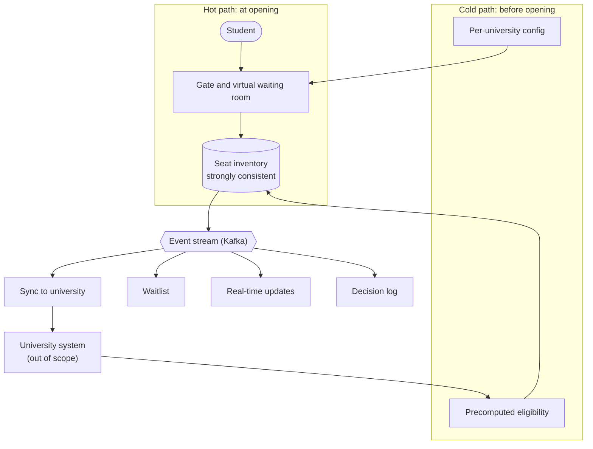

# Slot Gate

A high-load course registration platform for multiple universities. Slot Gate runs alongside each university's academic management system and keeps registration available and correct when tens of thousands of students arrive the moment registration opens: no crashes, no overselling.

> **Learning project.** Slot Gate runs on simulated data based on publicly available academic regulations. It is not used for any real university's registration and contains no real personal data.

Course project for *Technology Project* (Dự án Công nghệ) 2026 at VNU University of Engineering and Technology, and the groundwork for a graduation thesis.

## Problem

Course registration at many Vietnamese universities slows down or crashes in the first minutes after opening (sources in the [PRD](docs/prd-2026-10-17.pdf)). Slot Gate addresses the technical side: staying available under the opening spike and allocating seats correctly. It does not create seats; a shortage of class sections is a separate problem.

## Goals

1. **No overselling, fair ordering**, even under concurrent requests.
2. **Withstand the opening spike** with measurable latency.
3. **One platform, many universities**: each university declares its rules in a versioned configuration schema.
4. **Tenant isolation**: a busy university does not slow down the others.
5. **Explainable and debuggable**: every decision can be explained ("why was I rejected?"), and every incident can be investigated with traces, logs and metrics.

**Non-goals:** replacing the academic management system (student records, prerequisites and tuition stay there), creating seats or scheduling classes, production use for any real university, and a full-featured UI (the web client is the minimum needed to operate and observe the system).

## Targets

| Requirement | Target |
|---|---|
| Opening spike | 20,000 students, 90% of requests within the first 60 s |
| Request acknowledgement | p99 < 300 ms |
| Seat count and queue position updates | < 2 s |
| Correctness | 0 oversold seats; exactly one final outcome per request, including retries |
| Integration failures | A slow or unavailable university system never loses an accepted registration |
| Tenant isolation | Load on one university does not push another's p99 above target |

These are draft targets set by the author, not measured from any real university. They will be calibrated after the first measurements, and a new service is split out only when a target is violated.

## Architecture (planned)

Heavy rules are evaluated ahead of time on the **cold path**. At opening time, the **hot path** only reserves a seat in the seat inventory and publishes an event; everything else reacts asynchronously.



Tenancy starts as one shared deployment with per-university quotas and queues, designed so that a large university can later move to a dedicated deployment (cell model).

## Current state

The code and documentation are bootstrapped from [LearnEventDrivenArchitecture](https://github.com/phuck40clnq/LearnEventDrivenArchitecture), the author's earlier project, at commit `efff362`. Its history is not carried over. Starting point:

| Component | What it does |
|---|---|
| [`gateway-service`](services/gateway-service/README.md) | Spring Cloud Gateway: routing, JWT verification via JWKS, identity propagation, unified error responses |
| [`auth-service`](services/auth-service/README.md) | Registration, login, RS256 JWT issuance, JWKS endpoint; publishes `UserRegistered` and `UserLoggedIn` |
| [`user-service`](services/user-service/README.md) | User profiles; consumes `UserRegistered` |
| [`seat-inventory-service`](services/seat-inventory-service/README.md) | Sections and seats: holds that never exceed capacity, proven under concurrency |
| `test-service` | Sandbox for routing, contract and event experiments |
| [`contracts/`](contracts/README.md) | OpenAPI and Avro contracts, the source of truth between services |
| [`platform/java/`](platform/README.md) | Shared Maven BOM and parent POM |
| [`templates/`](templates/README.md) | Spring Boot service template |
| [`frontend/web/`](frontend/web/README.md) | Vanilla JS client: login, registration, profile |

Not in place yet: container images, seat hold expiry and confirmation, waiting room, rate limiting (the gateway filter is an empty stub), idempotent consumers, retry and dead-letter handling, outbox, tracing across Kafka, load tests, and automated tests in gateway, auth and user beyond context loading.

## Roadmap

| Phase | Scope | Exit criterion |
|---|---|---|
| 1. Fault-tolerant core | Seat inventory without overselling, idempotency, retry and dead-letter, outbox | Every failure scenario has before/after measurements |
| 2. Multi-tenancy | Versioned config schema, tenant isolation, hot/cold path split | Two simulated universities with different rules run side by side without affecting each other |
| 3. Observability and investigation | Tracing across Kafka, realistic load simulation, post-mortems | Root-cause an incident staged by someone else, without prior knowledge of it |
| 4. Wrap-up | Before/after data, final report, thesis directions | |

Phase lengths will be fixed once the course milestones are known. Each week follows one loop: write a prediction, break the system to reproduce it, fix it with one pattern, record an ADR, measure before and after.

## Repository structure

```text
.
├── contracts/        # OpenAPI and Avro contracts
├── docs/             # PRD, architecture, ADRs, rules
├── frontend/web/     # Minimal web client
├── infrastructure/   # Local infrastructure (PostgreSQL setup, Kafka)
├── platform/java/    # Shared Maven BOM and parent POM
├── services/         # Backend services
└── templates/        # Service templates
```

## Getting started

Requirements: Java 21, Maven 3.9+, PostgreSQL 14+ on `localhost:5432`. Docker with Compose is needed only to run Kafka.

1. Install the shared POMs. Services inherit from `platform/java`, which is not published to any repository:

   ```bash
   mvn -f platform/java/java-bom/pom.xml install
   mvn -f platform/java/java-parent/pom.xml install
   ```

2. Create one database and role per service (run once, see [`infrastructure/postgres/`](infrastructure/postgres/README.md)):

   ```bash
   psql -d postgres -f infrastructure/postgres/create-service-databases.sql
   ```

3. Generate the JWT key pair for auth-service (run once per machine; both files stay out of Git):

   ```bash
   cd services/auth-service/src/main/resources/keys
   openssl genpkey -algorithm RSA -out private.pem -pkeyopt rsa_keygen_bits:2048
   openssl rsa -pubout -in private.pem -out public.pem
   cd -
   ```

4. Run a service with the `local` profile:

   ```bash
   cd services/auth-service
   SPRING_PROFILES_ACTIVE=local OAUTH_JWK_SET_URI=http://localhost:8082/oauth2/jwks ./mvnw spring-boot:run
   ```

Services start without Kafka, but events are not delivered. To run it:

```bash
docker compose -f infrastructure/kafka/docker-compose.yml up -d
```

## Documentation

- [PRD](docs/prd-2026-10-17.pdf) (Vietnamese)
- [Contributing](CONTRIBUTING.md): issues, branches, commits and pull requests
- [Coding](docs/rules/coding.md), [Java](docs/rules/java.md) and [testing](docs/rules/testing.md) standards
- [Documentation index](docs/README.md)
- [Architecture overview](docs/architecture/overview.md)
- [Architecture decision records](docs/adr/overview.md)
- [Governance rules](docs/rules/governance.md)
