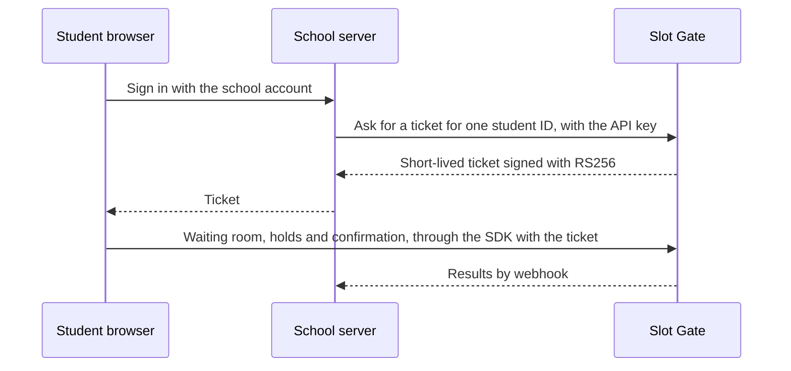

# ADR-0009: Serve schools through an API and a software development kit (SDK), not a student web client

## Status

Proposed

## Context

[Product](../core/product.md) and the [product requirements](../prd-2026-10-17.pdf) show students reaching Slot Gate through a web client of its own. A school that adopts Slot Gate would then send its students to a page that is not its own, which raises three problems:

- A school wants registration under its own brand, beside the rest of its student portal.
- Assumption: a student sent from the school portal to an unknown domain and asked to sign in again sees what a phishing page looks like.
- Slot Gate would have to keep student accounts or federate each school's sign-in, while the school system already keeps student records.

The product requirements report school systems that crash in the first 10 to 15 minutes of opening, and CORE-14 keeps school systems off the hot path. Assumption: if every hold went through the school's server, the opening peak in [product](../core/product.md#targets) would land on that same server.

The demo for the supervisor needs a customer that uses the API as a school would, and no school uses Slot Gate yet. Following the registration flow of a real school makes the demo familiar to students. Copying its pages would take work that is not ours and pass for the official site.

## Options

- **Hosted page on a Slot Gate domain:** rejected, because the school loses its brand, students meet an unknown domain, and Slot Gate keeps accounts.
- **Widget embedded in the school's page:** rejected for now, because the school controls only the look the widget allows. Assumption: browser limits on third-party frames and cookies make sign-in inside a frame fragile.
- **Page hosted on the school's domain:** rejected for now, because Slot Gate manages a certificate per school and still owns every school's design.
- **School server in front of every call:** rejected, because the opening peak lands on the school's server, the failure Slot Gate exists to prevent.
- **API and SDK, with the browser calling Slot Gate directly:** chosen, because the school keeps its pages and accounts, and its server handles one ticket request per student session instead of every hold.

## Decision

Offer schools two things: the Slot Gate API, and a TypeScript SDK that calls it correctly.

- A school builds its student pages with its own brand and keeps its student accounts.
- The gateway verifies the ticket with the public key from the JWKS, as it does every token today under [ADR-0003](0003-use-jwt-rsa.md).
- Slot Gate keeps the student ID only: no account, password, name or email of a student.
- Slot Gate offers no widget, no redirect to a Slot Gate domain and no page hosted on a school's domain, until a real school needs one.

The API key, the ticket request and the webhook get their own contracts.

A fictional demo school plays the customer:

- It uses the SDK and the API as a real school would, and its name, logo and colours are ours.
- Its pages follow the registration flow of `<reference school>` as closely as possible, rebuilt from nothing.
- It copies no markup, style sheet, script, image, icon, font, logo or verbatim text of that school.
- Nobody accesses that school's site automatically, stores its responses or uses its data, and no load test ever targets it.
- Its README in English and the footer of every page in Vietnamese credit the source: "Bản mô phỏng để test, dựa theo luồng đăng ký học của `<reference school>`. Không phải trang chính thức, không liên kết với trường. Dữ liệu tự sinh."

The public demo, when it exists, is a sandbox with a connection guide and the demo school as a sample app that developers run themselves. The demo school is never hosted publicly, because its pages follow a real school's flow.

## Consequences

Better:

- The opening peak goes from browsers to Slot Gate, and the school's server sees one ticket request per student session.
- A leak of Slot Gate data exposes student IDs, not names, emails or passwords.
- Schools keep their brand and their sign-in.
- The demo exercises the product the way a customer would, through the SDK and the API.

Worse:

- A school needs developers to build its pages, and one without them cannot use Slot Gate.
- The gateway accepts cross-origin calls from every school's domain, so the allowed origins become tenant configuration.
- The SDK is a second public interface, versioned with the API, and a break in it reaches every school's pages.
- Whoever holds a ticket acts as that student until it expires, so the ticket lifetime bounds the damage of a leak.
- Support cannot find a student by name; only the school maps an ID to a person.
- The sign-in by email and password of `auth-service` no longer serves students, and its redesign needs its own decision.
- Students sign in near opening, so the school's server still meets a peak of sign-ins. Assumption: a school's sign-in already bears that peak today.
- The demo school is more work than the minimal web interface the product requirements planned, and the credit line and bans above are all that keep it from passing for the official site.

To watch:

- Assumption: schools accept building their own pages. The first school that asks for a hosted page or a widget reopens that option.
- [Product](../core/product.md) changes to match once this ADR is accepted, as DOC-57 requires.
