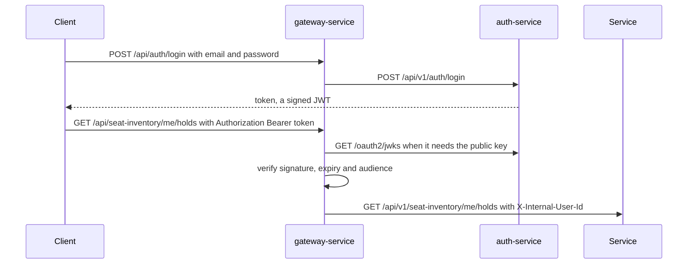

# Authentication

How a caller proves who it is and how that identity reaches the services today, for anyone who changes `auth-service`, the gateway or a service that reads the caller. The rules it follows are CORE-12 and API-16.

## Flow

## Endpoints of `auth-service`

| Endpoint | What it does |
|---|---|
| `POST /api/v1/auth/register` | Creates a user with a BCrypt hash of the password, publishes `UserRegistered`, returns an access token |
| `POST /api/v1/auth/login` | Checks the password, publishes `UserLoggedIn`, returns an access token |
| `POST /api/v1/auth/refresh` | Returns the fixed string `fake-refreshed-token` and issues no token |
| `GET /oauth2/jwks` | Serves the public key as a JSON Web Key Set |

## Access token

| Property | Value |
|---|---|
| Format | JWT signed with RS256 |
| Key | One RSA key pair, generated once per machine as the root `README.md` describes, with one fixed key ID and no rotation |
| `iss` | The value of `OAUTH_JWK_SET_URI` |
| `sub` | The ID of the user |
| `aud` | `gateway` |
| `iat` and `exp` | The time of issue, and 900 s later |
| Permissions | None: the token says who the caller is, not what it may do |

## Verification at the gateway

- The gateway checks the signature against the key set at `OAUTH_JWK_SET_URI`, the expiry, and the audience `gateway`. It does not check the issuer.
- Every `OPTIONS` request, `GET /actuator/health`, and every request to `/api/auth/**`, `/api/test/**` or `/public/**`, passes without a token.
- Any other request without a valid token is rejected with `401`.
- `POST /api/seat-inventory/sections` is rejected with `403` even with a valid token, because a token names a student and a student must not open a section.
- On a request with a valid token, the gateway sets `X-Internal-User-Id` to the `sub` claim, replacing any value the client sent.
- On a request to `/api/auth/**` or `/api/test/**`, which needs no token, the gateway removes any `X-Internal-User-Id` the client sent.

## In the services

A service reads the caller only from `X-Internal-User-Id` and never sees a password or a token. Each service decides from its own data what the caller may do, because tokens carry no permissions.

## Details

- [ADR-0003](../adr/0003-use-jwt-rsa.md): why tokens are JWTs signed with RSA
- [`auth-service`](../../services/auth-service/README.md) and [`gateway-service`](../../services/gateway-service/README.md)
