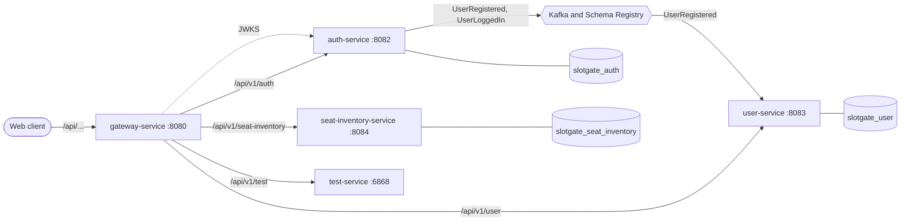

# Architecture overview

How the components of Slot Gate work together today, for anyone changing more than one of them. Each component's README holds its own details.

## Components and connections

## Request path

1. A client calls the gateway at `/api/<service>/...`.
2. The gateway verifies the JWT against the JWKS that `auth-service` serves at `/oauth2/jwks`, except on `/api/auth/**` and `/api/test/**`.
3. The gateway sets `X-Internal-User-Id` to the subject of the token, rewrites the path to `/api/v1/<service>/...` and forwards the request.
4. The service reads the caller only from `X-Internal-User-Id`, following CORE-12, and answers errors in the format of [the error contract](../../contracts/openapi/error/error.openapi.yaml).

## Events

Events are Avro records, defined in `contracts/avro/` and registered in Schema Registry, following the [event standard](../standards/events.md).

| Event | Topic | Producer | Consumers |
|---|---|---|---|
| `UserRegistered` | `auth-user-events` | `auth-service` | `user-service` |
| `UserLoggedIn` | `auth-security-events` | `auth-service` | None |
| Any | `auth-auth-events` | None in this repository | `auth-service` |

## Data

Each service with state owns one PostgreSQL database and role, following CORE-10:

| Service | Database | Schema changes |
|---|---|---|
| `auth-service` | `slotgate_auth` | Versioned migrations |
| `user-service` | `slotgate_user` | Generated from the entities at start-up; only validated in `prod` |
| `seat-inventory-service` | `slotgate_seat_inventory` | Versioned migrations |

`gateway-service` and `test-service` keep no state.

## Details

- [`gateway-service`](../../services/gateway-service/README.md)
- [Authentication](authentication.md)
- [Event standard](../standards/events.md)
- [Architecture decision records](../adr/README.md)
