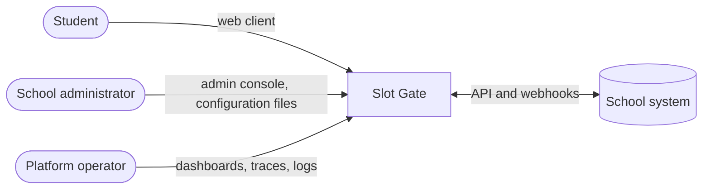

# Product

What Slot Gate is, who uses it, what it does, the terms every document and service uses, and the targets it is measured against. It binds every contributor, and changing it follows DOC-57.

## What Slot Gate is

Slot Gate is a course registration platform shared by many schools. It runs beside each school's academic system and keeps registration available and correct when tens of thousands of students arrive as a round opens. It runs on simulated data based on public regulations.

## Who uses it

| Role | What they do |
|---|---|
| Student | Waits for admission, holds and confirms seats, joins waitlists |
| School administrator | Configures rounds, rehearses them under simulated load, reads reports |
| School developer | Connects the school system through the API and webhooks |
| Platform operator | Monitors, investigates incidents, deploys |

## Scope

In priority order, Slot Gate:

1. Admits students through a waiting room at a set rate
2. Holds seats until confirmed or expired, never beyond capacity
3. Promotes the next waitlisted student when a seat frees up
4. Applies each tenant's versioned configuration
5. Checks eligibility with the school system before a round opens
6. Pushes seats left and queue position to students as they change
7. Sends results to the school system, retrying until delivered
8. Records why each outcome happened
9. Rehearses a round under simulated load

It does not replace the school system, which keeps student records, prerequisites and fees, nor create seats or schedule classes.

## Concepts

Code writes each name in the casing of its language or format: `SeatHold`, `seatHold`, `seat_hold`.

| Term | Name in code | Meaning |
|---|---|---|
| Tenant | `tenant` | A school on Slot Gate, with its own configuration, data and load limits |
| Student | `student` | A person registering in one tenant's sections |
| Registration round | `registrationRound` | A registration period with an opening time and one configuration version |
| Configuration | `configuration` | A tenant's versioned rules: opening time, credit cap, priority groups, hold duration, waitlist policy |
| Section | `section` | A class with a code unique within its tenant and a fixed capacity |
| Seat | `seat` | One place in a section |
| Hold | `seatHold` | A seat kept for one student: `HELD` until it is `CONFIRMED` or `EXPIRED` |
| Waiting room | `waitingRoom` | The queue students join when a round opens |
| Waitlist | `waitlist` | The ordered students waiting for a seat in a full section |
| School system | `schoolSystem` | The tenant's academic system: it answers eligibility checks and receives results |
| Hot path | | The work while a round is open: admitting, holding, confirming |
| Cold path | | The work before a round opens: configuration and eligibility |

## Targets

| Target | Value |
|---|---|
| Opening peak | 20,000 students, 90 % of their requests in the first 60 s |
| Request acknowledgement | p99 under 300 ms |
| Seats left and queue position | Shown within 2 s of a change |
| Tenant isolation | Another tenant's peak keeps a tenant's p99 under 300 ms |

Assumption: these targets are first estimates, not measured at any school, and each is revised by the measurement that tests it.
